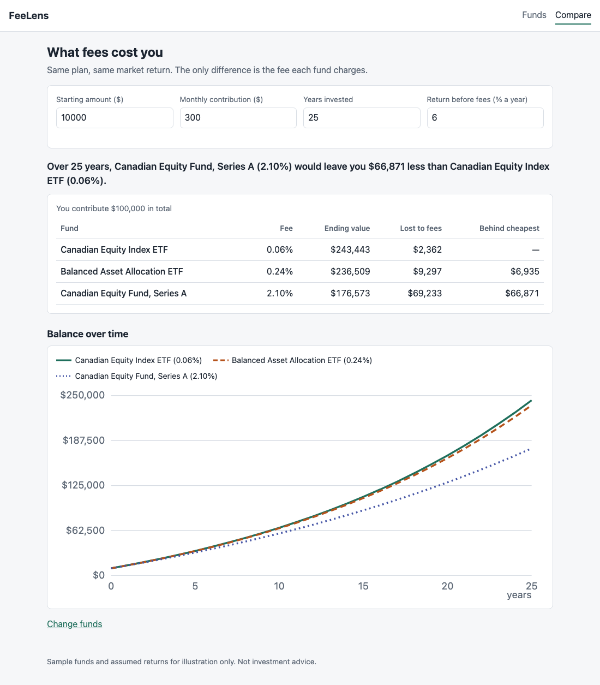

# FeeLens

An Angular app that shows what fund fees cost over time. Pick two or three funds, set a savings plan,
and see how much less the higher-fee fund leaves you with: same contributions, same market return,
only the fee differs.

**Live:** https://yang-zhang1994.github.io/feelens/



With $10,000 to start, $300 a month, and 6% a year before fees for 25 years, a 2.10% fee leaves
**$66,871 less** than a 0.06% index ETF ($176,573 vs $243,443).

The funds are sample data with typical Canadian fee levels, not real products, and the return is an
assumption. It is not investment advice.

## How it is built

| Part | Angular feature |
|---|---|
| `lib/fund.service.ts` | `HttpClient` loads `funds.json`; state exposed as a signal (loading / ready / error) |
| `funds/fund-list` | Reactive form for search, category and sort; computed signal for the filtered list; max 3 picks |
| `compare/compare` | `?ids=` bound straight to a component input, so any comparison is a shareable link; validated reactive form |
| `chart/growth-chart` | Hand-drawn SVG line chart with a fixed viewBox, dashed lines so it reads without colour |
| `app.routes.ts` | Lazy-loaded routes, per-page titles, unknown routes redirect to the list |

Fees are modelled as the MER subtracted from the annual return, compounded monthly. "Lost to fees" is
the no-fee balance minus the fund's balance, so it includes the growth the fees would have earned.

## Testing

| Layer | Tool | What it checks |
|---|---|---|
| Unit (20 tests) | Vitest via `ng test` | Fee math against closed-form answers, filtering, link parsing, both pages with a mocked HTTP backend, validation |
| End to end (20 runs) | Playwright, desktop Chrome + Pixel 7 | Filter → pick → compare → back; shared link survives reload; 3-fund cap; invalid input; unknown routes; any console error fails the test |
| Accessibility | axe-core (WCAG 2.1 AA) | Both pages. It caught a scrollable table that keyboard users could not reach on mobile; fixed with a focusable region |
| Performance | Angular bundle budgets + Playwright timing | Build fails if the initial bundle passes 350 kB or the compare chunk passes 25 kB; the list must render in under 2 s with under 350 kB of JS |
| Layout | Playwright | No horizontal page scroll on either page at phone width |

The end-to-end tests run against the static production build (`ng build` + `serve -s`), the same files
GitHub Pages serves. CI runs everything on each push and deploys to Pages only when the tests pass.

## Run it

```bash
npm ci
npm start                     # http://localhost:4200
npx ng test --watch=false     # unit tests
npx playwright install chromium
npx playwright test           # end-to-end, accessibility, performance
```
